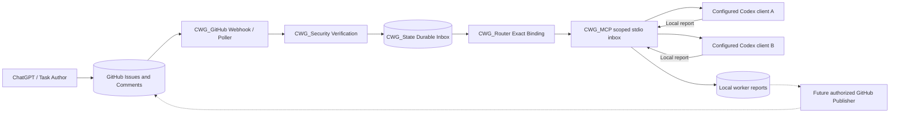
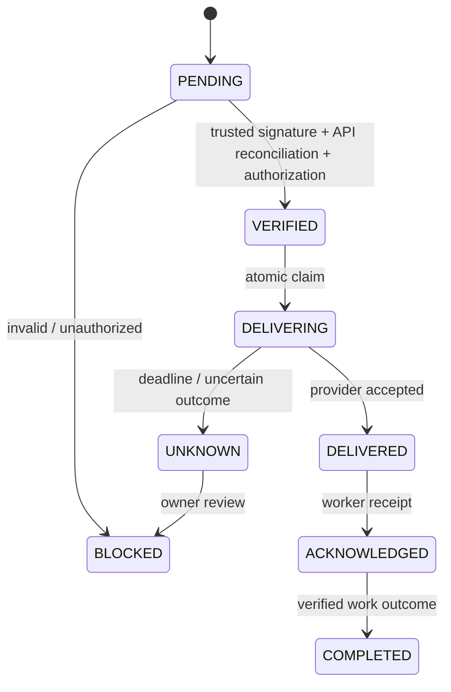

# Architecture map

The event loop is not a shell runner. Transport acknowledgement, agent acknowledgement, and task completion are separate facts. No claim of active delivery until an actual provider integration is tested.

## Implementation boundary

The Protocol, Router, Security, GitHub receiver, State and MCP sources are now
Cargo workspace members in this draft stack. The GitHub receiver has bounded
webhook/API reconciliation and durable inbox source, but its native Windows
verification remains NOT_RUN. The MCP provides a **pull-only** stdio tool
surface and local worker-report outbox; this does not prove that a Codex chat
received a message. No authenticated proactive Codex App Server adapter or
outbound GitHub publisher exists. Logical tests do not establish provider
thread/account isolation, and owner-controlled ACLs remain a prerequisite.

Repository-name matching is ASCII case-insensitive; thread/provider/GOAL matching is exact. [Protocol rules](protocol.md) and [tests](testing.md) define the implemented scope. No diagram edge or model test proves actual GitHub-to-Codex delivery.

Router admission has finite binding/message/body budgets. Every message-state operation uses an explicit repository/GOAL/target/message key. Binding suspension is separate from DeliveryStatus: it prevents new admission and claims while retaining replay history and recording already-dispatched outcomes. It does not authenticate an operator, detect stale provider threads or implement persistent recovery.
