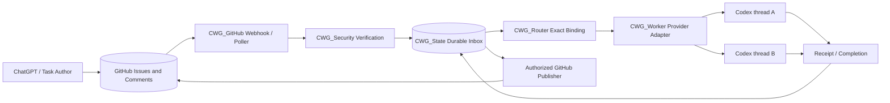
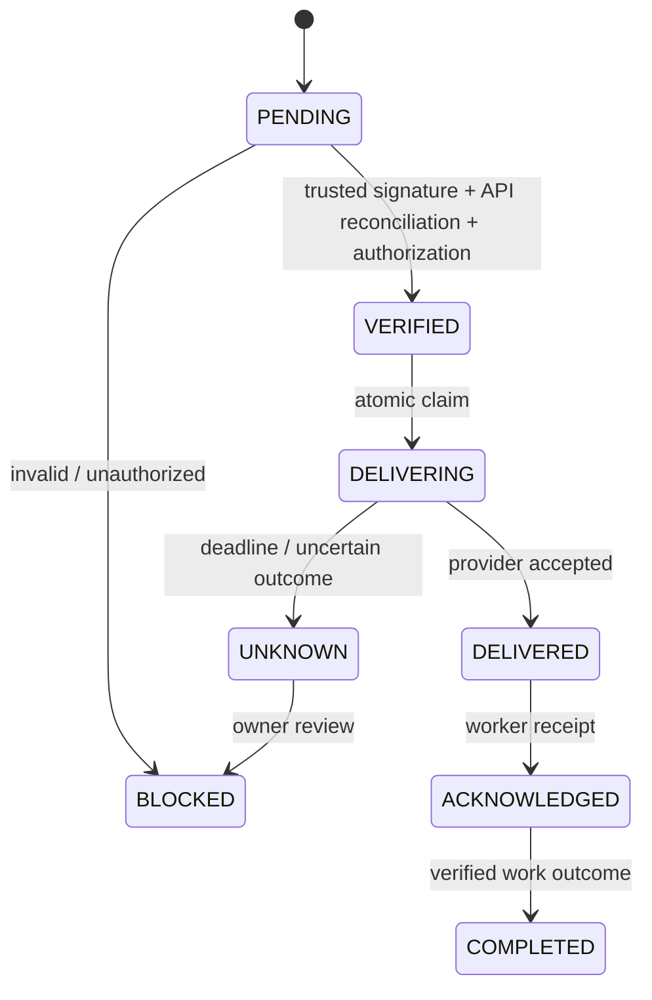

# Architecture map

The event loop is not a shell runner. Transport acknowledgement, agent acknowledgement, and task completion are separate facts. No claim of active delivery until an actual provider integration is tested.

## Implementation boundary

Only `CWG_Protocol` and `CWG_Router` are Cargo workspace members. The other component directories contain planned-interface documentation. Router starts storage at VERIFIED after a trusted controller's ingress checks. The PENDING/signature/API/authorization path in this diagram is still design only. Router now records every depicted post-VERIFIED transition, but does not verify the external observations that authorize each transition. It has no transport, database or account-aware thread adapter.

Repository-name matching is ASCII case-insensitive; thread/provider/GOAL matching is exact. [Protocol rules](protocol.md) and [tests](testing.md) define the implemented scope. No diagram edge or model test proves actual GitHub-to-Codex delivery.

Router admission has finite binding/message/body budgets. Every message-state operation uses an explicit repository/GOAL/target/message key. Binding suspension is separate from DeliveryStatus: it prevents new admission and claims while retaining replay history and recording already-dispatched outcomes. It does not authenticate an operator, detect stale provider threads or implement persistent recovery.
