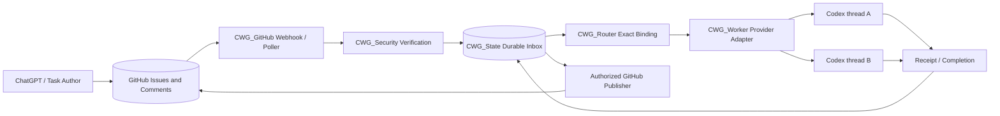
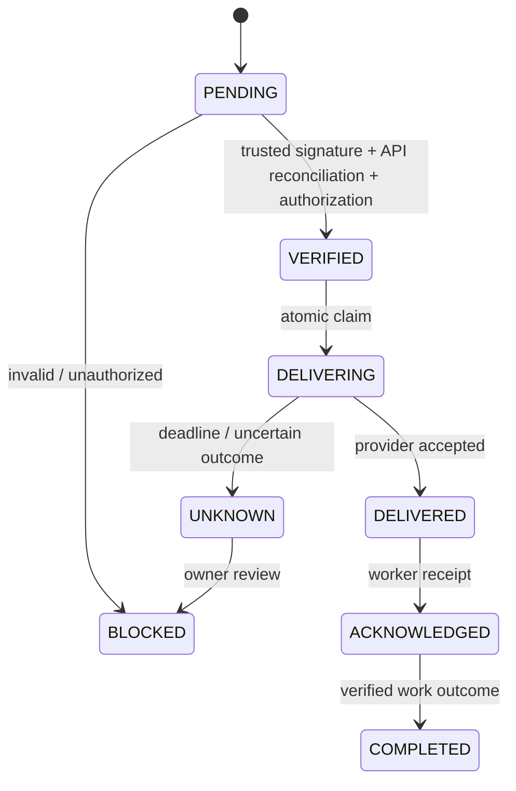

# Architecture map

The event loop is not a shell runner. Transport acknowledgement, agent acknowledgement, and task completion are separate facts. No claim of active delivery until an actual provider integration is tested.
