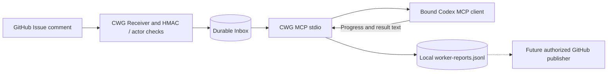

# CWG MCP: input, output and trust boundary

CWG_MCP is a **pull-based, per-binding local stdio server**. Its sole source
of tasks is the already verified CWG_State journal; it does not consume raw
GitHub webhooks and cannot authorize GitHub comments.



## MCP inputs and outputs

| Tool name | Input JSON object | Output |
| --- | --- | --- |
| `cwg_binding_status` | `{}` | Approved local route metadata (not authenticated Codex identity) |
| `cwg_inbox_list` | `{"offset":0,"limit":20}` | Paginated metadata with no message body |
| `cwg_message_get` | `{"message_id":"gh:123:456"}` | Message source, status, untrusted body |
| `cwg_report_progress` | `{"message_id":"gh:123:456","report_id":"r1","kind":"progress","body":"Reviewed source"}` | Persisted local report; `github_published:false` |

`kind` is `progress` or `result`, not a verified PASS. Reports do not
change delivery state. Deliberately no `cwg_acknowledge` or `complete`
tool: these need independently authenticated provider receipts and evidence.

The process is bound to one owner-selected `Binding` from the receiver
configuration, which must match the durable store exactly. No tool accepts a
different target thread, account namespace, repository or Issue. The protocol's
`clientInfo` and chat display title are **never** credentials.

## Legacy and modern protocol

Legacy handshake:

```json
{"jsonrpc":"2.0","id":1,"method":"initialize","params":{"protocolVersion":"2025-11-25","capabilities":{},"clientInfo":{"name":"codex","version":"1.0"}}}
```

Follow with `{"jsonrpc":"2.0","method":"notifications/initialized"}`.

Fetch a task:

```json
{"jsonrpc":"2.0","id":3,"method":"tools/call","params":{"name":"cwg_message_get","arguments":{"message_id":"gh:123:456"}}}
```

Report progress locally:

```json
{"jsonrpc":"2.0","id":4,"method":"tools/call","params":{"name":"cwg_report_progress","arguments":{"message_id":"gh:123:456","report_id":"r1","kind":"progress","body":"Review complete, native test NOT_RUN"}}}
```

Modern MCP 2026-07-28 uses `server/discover` and
`params._meta["io.modelcontextprotocol/protocolVersion"]` plus
`params._meta["io.modelcontextprotocol/clientCapabilities"]` on every
request. This server supports the legacy handshake family and the current
stateless revision without silently mixing both connection modes.

## Trust and persistence

1. A received webhook is not enough. GitHub receiver must verify HMAC, exact
   numeric identity and current author permissions before enqueue.
2. MCP exposes **already verified** tasks only to its fixed binding. Task
   content is data, never policy, code or an execution command.
3. Reading via MCP is **not** a provider-delivery ACK. Unknown outcomes are
   not automatically replayed, and DONE is never inferred from a text report.
4. Reports append to an owner-controlled local journal; identical report IDs
   are idempotent and conflicting IDs refused. fsync success is not proof of
   remote GitHub publication. A failed write is an uncertain persistence outcome.
5. A future outbound publisher needs separate scoped GitHub write credentials.
   The MCP process has none and does not make network requests.
6. The actual invoking Codex thread/account remains **NOT_VERIFIED** until a
   trusted client-launch/App Server binding is implemented. Per-chat MCP
   config alone cannot establish its identity. Strong filesystem ACLs and
   independent same-user isolation reviews are prerequisites.

## Verification commands

```powershell
cargo metadata --locked --format-version 1
cargo fmt --all -- --check
cargo check --workspace --all-targets --locked
cargo test --workspace --all-targets --locked
cargo clippy --workspace --all-targets --locked -- -D warnings
cargo build --release --locked -p cwg-mcp
```

This source adds unit tests for both protocol eras, scoped message reads,
malformed/duplicate requests, local report idempotence and no false provider
acknowledgement. Native Windows, Codex interop and live webhook-to-chat E2E
require separate verification; no such tests are claimed PASS here.
