# Created-comment receiver and persistent inbox

## Scope

This change adds Rust source for a Windows-native foreground receiver, not a
placeholder which always refuses. `cwg-github serve` can validate a webhook,
reconcile its author/source with GitHub and commit a message to a local inbox.
**Compilation and native execution of this new source are NOT_RUN.** Review and
run the commands below before deployment. The earlier
Protocol/Router audits do not qualify this new code. The concurrent security
review in PR #1 at `a7aa73858a85620f4ca10f09fcf75d86186f662c` is incorporated
without changing its source or tests. Journal transitions now use its exact
repository/GOAL/target/message MessageKey, not unscoped message IDs.

Implemented path:

```mermaid
flowchart LR
  GH[GitHub issue_comment created] --> TLS[Operator-managed HTTPS reverse proxy]
  TLS --> HTTP[Loopback POST /github]
  HTTP --> MAC[Windows CNG HMAC over exact bytes]
  MAC --> API[Fixed-host GitHub API reconciliation]
  API --> Route[Owner-configured numeric repo and Issue route]
  Route --> Journal[Locked and fsynced local inbox]
  Journal --> Inbox[Explicit local inbox inspection]
```



There is no Codex connection, automatic turn start, MCP server, background
installation, outbound GitHub publisher, or model/API spending in this change.
Reading an inbox is NOT delivery to a chat. The stored target/account is an
operator-configured namespace, not proof of real Codex account/thread ownership.

## Configuration and startup

Use Windows 10 or later with its existing SDK/MSVC build tools and the reviewed
Rust toolchain (the previous audit used 1.97.1; file locking requires >=1.89).
No new registry crate/version is introduced. Windows uses system BCrypt/WinHTTP;
serde and serde_json already existed in the workspace lock. Only local package
entries were added to Cargo.lock; Cargo must still validate that lockfile.

```powershell
cargo fmt --all -- --check
cargo check --workspace --all-targets --locked
cargo test --workspace --all-targets --locked
cargo clippy --workspace --all-targets --locked -- -D warnings
cargo build --locked -p cwg-github --release
```

Copy `examples/receiver.windows.example.json` outside the repository. Replace
all example IDs, register the intended issue and exact chat/account namespace,
select the authorized numeric sender IDs and set `not_before` to registration
time. Do not use a display chat name as identity. Keep the config and every
parent directory operator-controlled, without reparse points or symlink aliases.
Create an absolute, owner-only state directory with Windows ACLs **before**
launch. The application does not silently modify ACLs or provision accounts.

Supply `CWG_WEBHOOK_SECRET` and a repository-scoped, read-only
`CWG_GITHUB_TOKEN` through the approved local secret mechanism. No secret values
belong in JSON, Git, command arguments or public logs. The token must be able to
read the repository, selected issue/comment and current collaborator permission.
A 401/403/404 is refusal, not an authorization fallback. Consult the endpoint
permission documentation when provisioning the token; do not grant write access
as a workaround.

The example is disabled. After review, explicitly enable your local copy:

```powershell
.\target\release\cwg-github.exe check-config C:\CWG-Private\receiver.json
.\target\release\cwg-github.exe serve C:\CWG-Private\receiver.json
# In another terminal, for a previously registered route:
.\target\release\cwg-github.exe inbox C:\CWG-Private\receiver.json development
```

`check-config` validates structure only. It does not prove credentials, ACLs,
network access, thread identity, or deployment readiness. `serve` is foreground
and explicit, not an installed service. `inbox` is a local operator diagnostic
(first 100 records); output includes task content and must be treated as private.

The listener accepts only loopback addresses. GitHub cannot deliver directly to
127.0.0.1: an independently approved HTTPS reverse proxy is required. No proxy,
webhook subscription, firewall change, token or background task is installed by
this PR. The proxy must preserve exact raw bytes, constrain request size/rate,
and avoid body/token logging. The narrow endpoint rejects transfer/content
encoding, duplicate headers and unsupported framing; send Content-Length JSON.

## Authorization and routes

Only **new comments on explicitly registered Issues** are accepted. New Issues,
edits, labels, PR comments, bot senders and closed/locked Issues are refused.
This narrower surface is intentional. To change a task, post a new authorized
comment rather than silently replacing already delivered instructions.

The receiver checks raw HMAC before parsing or calling GitHub. It rejects
repeated JSON keys even in unknown GitHub extension objects. It then re-reads
four fixed-host endpoints: repository, issue, comment, and author permission.
Numeric repository and owner IDs, Issue identity, comment author, unchanged body
and timestamps, cutoff, optional installation ID, and current write/maintain/admin
permission must agree. URLs from payloads are never requested. TLS verification
is not bypassed; WinHTTP redirects, automatic credentials, cookies and proxy
discovery are disabled. HTTP GET only, no automatic network retries.

The destination, GOAL, account namespace and generation come from local config,
never from comment text. Message IDs are allocated as `gh:REPOSITORY_ID:COMMENT_ID`.
Changing X-GitHub-Delivery cannot create another message for that same comment.

## Persistence and failure semantics

`CWG_State` persists bindings, puts and transitions in `inbox.jsonl`, reusing
`CWG_Router` for transition validation. Each operation locks the file, replays its
bounded journal, validates the update, appends one record and calls `sync_all`
before reporting success. Separate processes use the OS file lock; busy callers
are refused. Single-host local storage only, not a distributed queue.

An identical replay is a no-op. Conflicting body, route/generation changes and
out-of-order state changes are refused. An unfinished DELIVERING claim remains
non-retryable after reopening; a trusted future adapter must reconcile it and
record UNKNOWN when appropriate. No receiver operation emits DELIVERED,
ACKNOWLEDGED or COMPLETED. State-library transitions have trusted-controller
preconditions and are not remotely exposed.

A torn/invalid record, sequence gap or capacity limit blocks access without
truncation. A write/fsync error reports STATE_COMMIT_UNKNOWN: inspect/reconcile;
do not assume the append did not happen. Bounds: 128 bindings, 1,024 messages,
20,000 records and 32 MiB journal, 512 KiB per HTTP/JSON/record input. The
underlying Router additionally enforces its 16 MiB total message-body budget. There is no
automatic pruning; deleting the journal would destroy replay protection. Archive
and compaction require a later reviewed implementation preserving tombstones.

Local file/parent ACLs are a prerequisite. Path checks reject observed links and
Windows reparse points, but do not establish resistance to a hostile same-user
process replacing files concurrently. The journal is not encrypted or
cryptographically tamper-proof. Power-loss durability, NTFS ACLs, process crash
injection and native concurrency still require Windows qualification. A local
administrator or process able to modify config/journal is outside this boundary.

## Tests and acceptance gates

New Rust tests cover nested duplicate keys, HMAC parsing/comparison and the
GitHub official vector (Windows CNG), HTTP framing/limits, current permission,
repository recreation/transfer, edited/stale comments, incorrect installation,
wrong routes, restart/dedupe, torn records, state-order errors and competing
claims. The signed fixture is synthetic and uses a public test-only key. Mock
API tests prove reconciliation logic only. They do not prove TLS or live GitHub.

This editing environment has no rustc/cargo and no Windows runtime. Therefore
Cargo fmt/check/test/clippy, Windows CNG/WinHTTP, actual webhook delivery, real
Codex thread isolation and end-to-end delivery are **NOT_RUN**. No new Rust test
is reported as PASS. Existing tests/source in Protocol and Router are untouched.

Before promotion: run all Cargo gates on the exact resulting SHA; independently
review unsafe CNG/WinHTTP wrappers and the HTTP parser; verify filesystem ACLs;
exercise real signed authorized/unauthorized events through the approved proxy;
interrupt writes and concurrent processes; inspect persisted dedupe after reboot.
Native WinHTTP timeouts are per operation plus deadline checks between calls,
not a hard preemptive wall-clock scheduler. Reconciliation may exceed GitHub's
response deadline on a slow host; redelivery must remain idempotent. Flood/rate
control belongs at the approved proxy; this receiver is intentionally serial.

## Primary implementation references

- https://docs.github.com/en/webhooks/using-webhooks/validating-webhook-deliveries
- https://docs.github.com/en/rest/issues/comments
- https://docs.github.com/en/rest/collaborators/collaborators
- https://learn.microsoft.com/en-us/windows/win32/api/bcrypt/nf-bcrypt-bcrypthash
- https://learn.microsoft.com/en-us/windows/win32/winhttp/option-flags
- https://learn.microsoft.com/en-us/windows/win32/api/winhttp/nf-winhttp-winhttpqueryheaders
- https://doc.rust-lang.org/std/fs/struct.File.html#method.try_lock
